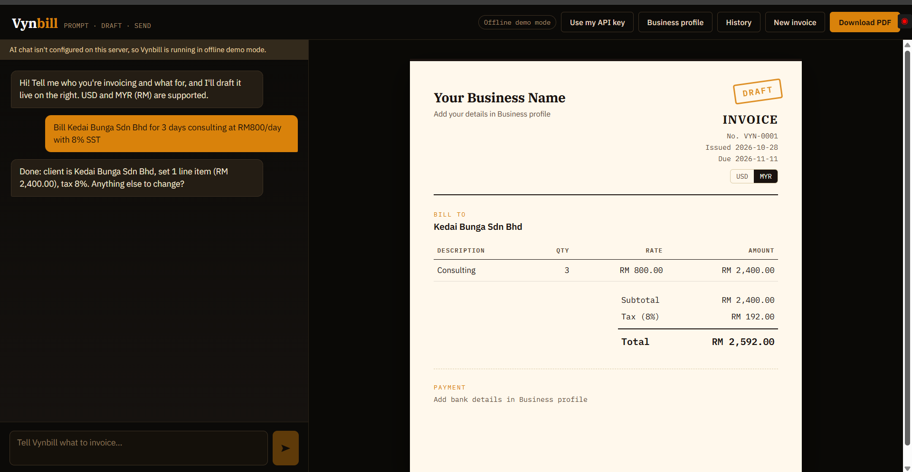

# Vynbill

**A prompt-first AI invoice generator for freelancers and small businesses.**
Describe what you're billing in plain English; Vynbill drafts the invoice live next to the chat. No forms to fill in.

> This is a working prototype built as a portfolio project. It has no accounts or database: everything you create is saved in your own browser.

<!-- Add a screenshot or GIF here once you've captured one:  -->

## Try it

**Live demo:** https://vynbill.vercel.app

Open it and click one of the example prompts, or type something like:

- `Invoice Acme Studio for 10 hrs design at $50/hr, due in 14 days`
- `Bill Kedai Bunga Sdn Bhd for 3 days consulting at RM800/day with 8% SST`
- then follow up with `Add 2 hours of revision at $60/hr` or `mark as sent`

Use **Business profile** to add your name, logo and bank details, **History** to reopen sent invoices, and **Download PDF** to save the invoice (the browser's print dialog, "Save as PDF").

## What makes it different

- **Prompt-first.** The chat is the interface. Most invoicing tools start from a blank form.
- **Two currencies, done properly.** Each invoice is billed in either USD or Malaysian Ringgit (MYR/RM), switchable per invoice. Anything else is politely refused. There is no currency conversion; you bill in what your client pays in.
- **Works without an API key.** With a Claude API key it is designed to use Claude to understand free-form requests (the API route is covered by request-validation and fallback checks; see Known limitations). Without one (or when the demo's usage limit is hit), it falls back to a built-in rule-based parser, so the demo never breaks. The header shows which mode you're in.
- **Private by default.** Invoices, history and your business profile live in your browser's `localStorage`. Vynbill stores nothing on a server. In AI mode, the text of your chat messages and the current invoice (including client names) are sent to Anthropic's API to generate replies; in offline mode nothing leaves your browser.

## Run it locally

Requires Node.js 20.9 or newer (Next.js 16's minimum).

```bash
git clone https://github.com/techrachel-98/vynbill.git
cd vynbill
npm install
npm run dev
```

Open http://localhost:3000. It starts in offline demo mode.

To enable AI chat, copy `.env.example` to `.env`, uncomment `ANTHROPIC_API_KEY`, and paste your key from https://console.anthropic.com/. Restart the dev server.

| Variable | Default | Purpose |
| --- | --- | --- |
| `ANTHROPIC_API_KEY` | _unset_ | Enables AI chat. Unset = offline demo mode |
| `ANTHROPIC_MODEL` | `claude-haiku-5-5` | Model used for chat (a small, cheap model is plenty for this task) |
| `DEMO_MAX_PER_HOUR` | `20` | AI requests allowed per visitor IP per hour |
| `DEMO_MAX_PER_DAY` | `300` | AI requests allowed across all visitors per day |

```bash
npm test      # unit tests for totals, formatting, validation and the offline parser
npm run lint
npm run build
```

### Bring your own key

Visitors can click **Use my API key** and paste their own Anthropic key to get AI replies on any deployment, including a demo that has no server key. The key is kept in that browser tab only (`sessionStorage`, forgotten when the tab closes) and is sent to the server in a request header, used for that one call, and never stored or logged. Requests with a visitor's key don't use the demo's daily budget, but keep a per-IP limit. A rejected key is removed automatically and the app falls back to offline mode.

## How it works

```
browser (React) ──► POST /api/chat ──► Claude ──► { reply, invoice } ──► validated ──► live preview
      │                   │ no key / limit / error
      │                   └──► 503/429/502 ──► browser falls back to the rule-based parser
      └── localStorage: invoice, history, business profile, chat
```

- `src/app/api/chat/route.js`: the chat endpoint. The **server builds the system prompt** from the current invoice, so visitors can't inject their own instructions or use the endpoint as a free general-purpose model. It validates the request, rate-limits, calls Claude, and parses the reply.
- `src/lib/invoice.js`: totals (discount before tax, rounded to cents), money formatting for USD/MYR, and `sanitizeInvoice`, which treats every model reply as untrusted input: unknown currencies, bad dates, negative or absurd numbers and oversized text are rejected or clamped.
- `src/lib/demoParser.js`: the offline fallback, a regex-based parser for phrasings like the examples above.
- `src/components/`: the React UI. The invoice is plain HTML/CSS with print styles, so PDFs are real vector text.

## Deploying (Vercel)

1. Push this repo to GitHub and import it in Vercel. No build settings needed.
2. Optional: add `ANTHROPIC_API_KEY` under Environment Variables to enable AI mode. Without it the live demo runs in offline mode.

## Known limitations (it's a prototype)

- Rate limits are in memory, per server instance. On serverless hosting they reset on cold starts and aren't shared between instances. Fine for capping a demo's spend, not for production; use a shared store (e.g. Redis) for that.
- The offline parser understands a fixed set of phrasings, not arbitrary English.
- Data lives in one browser: no sync between devices, and clearing site data erases it.
- Invoices can't be emailed from the app, and there are no payment links or reminders.
- Only USD and MYR.
- The live Claude reply path has not yet been exercised end to end with a real API key. Offline mode, request validation, rate limiting and the fallback behaviour have been tested.

## Design decisions

- **The server owns the prompt.** The browser sends only the chat messages and the current invoice; the system prompt is built server-side, so the endpoint can't be repurposed as a free general-purpose model.
- **Model output is untrusted.** Every reply goes through `sanitizeInvoice` before it touches the UI.
- **Graceful degradation.** A missing key, a rate limit or an API error all land on the offline parser instead of an error screen.
- **Cheap by design.** A small model, per-IP and global daily caps, and no persistence layer keep a public demo's cost near zero.

## Stack

Next.js 16 (App Router) · React 19 · Anthropic SDK · plain CSS · Node's built-in test runner.

## Licence

All rights reserved. This code is public for review and evaluation only; it is not licensed for copying, reuse or redistribution. See [LICENSE](LICENSE).
